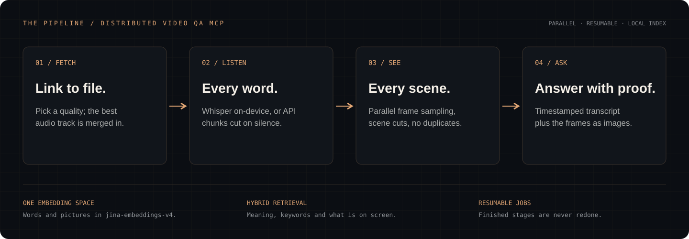

[](https://distributed.systems)

# Distributed Video QA MCP

**Give your MCP client a video link. It downloads the video with sound, transcribes it, indexes every scene, and answers questions with timestamps and the actual frames.**

[](https://github.com/arthurcolle/distributed-video-qa-mcp/actions/workflows/ci.yml)
**v0.2.0 · 19 typed tools · 5 resources · 5 prompts · Python 3.11+ · MIT**

[Quick start](#quick-start) · [Interface](#interface) · [Tool contract](docs/tool-contract.md) · [How it works](#how-it-works) · [Operations](docs/operations.md) · [Changelog](CHANGELOG.md)

Try asking your MCP client:

> Index https://www.youtube.com/watch?v=… and list every claim the speaker makes about pricing, with timestamps.

> Find the moment the architecture diagram is on screen and read me its labels.

> Ingest the first 20 videos of this playlist and tell me where they disagree about the roadmap.

> Download this link at 1080p with audio into ~/Movies.



## What it does

| | |
| --- | --- |
| **Link to file, with sound** | Above 360p most sites serve silent video plus a separate audio stream. `video_download` fetches both in parallel fragments and muxes them, preferring H.264/AAC so the file plays everywhere. `video_probe` shows the quality menu first and flags which qualities need the merge. Any site [yt-dlp](https://github.com/yt-dlp/yt-dlp) supports will work, including playlists and channels. |
| **Transcript** | Whisper large-v3-turbo runs on-device via MLX on Apple Silicon or faster-whisper elsewhere. Without a local model it uses any OpenAI-compatible endpoint, with the audio cut on silences and the chunks sent concurrently. |
| **Frames** | Frames are sampled at a fixed interval plus every scene cut, decoding the timeline in parallel FFmpeg segments. Near-duplicates are removed with a perceptual hash and a colour check, so a talking head doesn't use up the budget. |
| **One space for words and pictures** | Passages and frames are both embedded with [`jina-embeddings-v4`](https://jina.ai/embeddings/), so a text question can land directly on a frame with no captioning step. |
| **Hybrid retrieval** | Three channels: meaning-based transcript search, BM25 keyword search, and text-to-image search over frames. They are fused by weighted reciprocal rank, giving speech and picture equal say. Every hit reports which channels found it and how strongly. |
| **Evidence, not opinions** | `video_ask` returns moments, meaning transcript windows with the frames from them as images, plus raw match strength. Your client's model reads the screen itself and answers, and no second model is paid to summarise along the way. |

## Quick start

Requires FFmpeg on `PATH` and a [Jina API key](https://jina.ai/api-dashboard/).

```sh
git clone https://github.com/arthurcolle/distributed-video-qa-mcp.git
cd distributed-video-qa-mcp
uv venv && uv pip install -e ".[mlx]"            # Apple Silicon: on-device Whisper
# uv pip install -e ".[faster-whisper]"          # Linux, CUDA or CPU
# uv pip install -e .   + GROQ_API_KEY           # transcription over an API
JINA_API_KEY=… .venv/bin/distributed-video-qa-mcp doctor
```

`doctor` prints the backends it found and exits non-zero if ingest would fail. The install includes a Deno runtime for YouTube's signature challenge; without one, YouTube offers only low qualities.

**Claude Code**

```sh
claude mcp add video-qa -e JINA_API_KEY=… -- "$PWD/.venv/bin/distributed-video-qa-mcp"
```

**Any MCP host (stdio)**

```json
{
  "mcpServers": {
    "video-qa": {
      "command": "/absolute/path/distributed-video-qa-mcp/.venv/bin/distributed-video-qa-mcp",
      "env": { "JINA_API_KEY": "…" }
    }
  }
}
```

**Shared server (streamable HTTP)**

```sh
DVQA_HTTP_TOKEN=$(openssl rand -hex 32) distributed-video-qa-mcp serve --http --host 0.0.0.0 --port 4005 \
  --allowed-host video-qa.internal:4005
```

Clients send `Authorization: Bearer <token>` to `/mcp`; `/health` is open. The server refuses to bind a non-loopback address without a token. See [operations](docs/operations.md) for TLS, process supervision and backups.

## Interface

Every tool declares a typed result. The JSON Schema is published as the tool's `outputSchema`, every response is validated against it before it is sent, and it arrives as `structuredContent`. The full per-argument and per-field reference is **[docs/tool-contract.md](docs/tool-contract.md)**. It is generated from the code, and a test fails if it goes stale.

| Group | Tool | Returns | Does |
| --- | --- | --- | --- |
| Acquire | `video_probe` | `ProbeResult` | Quality menu for a link: sizes, and which qualities need an audio merge |
| | `video_download` | `Job` | Save video with audio merged, video only, or audio only (m4a/mp3/opus/flac/wav) |
| Index | `video_ingest` | `Job` | Download, transcribe, sample frames, embed; resumable |
| | `video_ingest_batch` | `BatchResult` | Many sources at once; playlists and channels expand |
| Jobs | `video_job` · `video_jobs` · `video_cancel` | `Job` · `JobList` · `CancelResult` | Wait with progress notifications, list, stop |
| Retrieve | `video_ask` | `AskResult` + images | Evidence moments for a question, with match strength |
| | `video_search` | `SearchResult` | Ranked hits over what was said and shown, filterable by time and video |
| | `video_search_by_image` | `SearchResult` | Frames resembling a picture you supply |
| | `video_find_phrase` | `PhraseResult` | Every occurrence of exact words |
| Inspect | `video_transcript` | `TranscriptResult` | Timestamped, plain, SRT, WebVTT or JSON, by range |
| | `video_frames` | `FramesResult` + images | Frames at exact instants, decoded at full resolution |
| | `video_chapters` | `ChaptersResult` (+ images) | Uploader chapters, or topic shifts found in the embeddings |
| | `video_clip` | `ClipResult` | Export a range to MP4, stream-copied or frame-accurate |
| Library | `video_list` · `video_info` · `video_delete` · `video_status` | `VideoList` · `VideoDetail` · `DeleteResult` · `StatusReport` | Manage the index; readiness and capacity |

### Anatomy of an answer

`video_ask(question="Why did he lose money on the Seoul bet?", max_moments=1, frames_per_moment=1)` against a 6½-minute video returns the structure below (transcript shortened), followed by a caption and the JPEG of each listed frame:

```json
{
  "question": "Why did he lose money on the Seoul bet?",
  "moments": [{
    "video_id": "cb5590f118d1",
    "span": "3:44-4:48",
    "matched_by": ["said_keyword", "said_semantic", "shown"],
    "transcript": [
      { "at": "3:48", "start": 228.7, "text": "So let me tell you about my Seoul, South Korea bet." },
      { "at": "3:58", "start": 238.6, "text": "But I sized in heavy, $300, it was at 62 cents." },
      { "at": "4:02", "start": 242.1, "text": "The problem? Seoul's temperature crept up all day and hit exactly 13." },
      { "at": "4:09", "start": 249.4, "text": "And under 13 means under, not equal to." }
    ],
    "frames": [{ "at": "4:01", "t": 241.9, "path": "…/frames/00066_000241900.jpg" }]
  }],
  "evidence": { "best_said_similarity": 0.62, "best_shown_similarity": 0.48, "keyword_matches": 9 },
  "guidance": "Answer only from this evidence and cite times as m:ss. Images follow in moment order."
}
```

`evidence` lets the model tell a real match from a near miss. On the same index, the off-topic question *"What is the capital of Australia?"* scored `best_said_similarity` 0.44 with **0** keyword matches.

### Errors

A failed call returns `isError: true` and text of a fixed format, so the code can be branched on:

```
Error executing tool video_ingest: path_not_allowed: /private/etc/hosts is outside the allowed roots; set DVQA_ALLOWED_ROOTS to widen them — Add the folder to DVQA_ALLOWED_ROOTS.
```

There are 30 registered codes in five categories (input, access, source, backend, state). Each one has a hint and a retryable flag, listed in the [contract](docs/tool-contract.md#error-codes). A test fails if the code raises an unregistered one.

### Resources and prompts

| Resource | Type |
| --- | --- |
| `video://library` | JSON list of indexed videos |
| `video://{video_id}/transcript` | Timestamped transcript |
| `video://{video_id}/subtitles.srt` | SRT subtitles |
| `video://{video_id}/info` | `VideoDetail` JSON |
| `video://{video_id}/frame/{seconds}` | JPEG of the nearest indexed frame |

| Prompt | Arguments | Produces |
| --- | --- | --- |
| `video_brief` | `source` | Ingest if needed; summary, chapters, key claims, open questions |
| `video_fact_check` | `video_id`, `topic?` | Table of verbatim claims with timestamps and on-screen support |
| `video_study_notes` | `video_id` | Terms, procedures, formulas and code as shown, review questions |
| `video_compare` | `video_ids`, `question` | Per-video answers, agreements and contradictions |
| `video_find_moment` | `description` | Located and visually verified moment, ready to clip |

## How it works

```
                 ┌─ audio ─ Whisper (on-device, or silence-cut chunks in parallel) ─ passages ─ text vectors ─┐
source ─ probe ──┤                                                                                            ├─ SQLite index
                 └─ frames (parallel FFmpeg segments: interval + scene cuts) ─ dedupe ─ image vectors ────────┘
```

- **Concurrent branches, resumable stages.** Speech and frames run at the same time. Each branch records a signature of its inputs (backend, model, dimensions, sampling settings) when it finishes. Re-ingesting skips matching stages, and changing a setting redoes only the stage it affects. Jobs left running by a crash are marked `interrupted` at startup.
- **Retrieval.** Transcript segments are grouped into ~30-second passages that overlap by one segment. A query runs dense passage search, BM25 over the passages (SQLite FTS5, porter stemming, stopwords removed), and dense frame search. Results are fused by reciprocal rank (k = 60). The two transcript channels are weighted ½ each, so a strong frame match is not outvoted two to one. Nearby hits merge into moments of at most 75 seconds.
- **Index.** A single SQLite file in WAL mode holds segments, passages, frames, the FTS table and float32 vectors. Vector search is exact: each vector set is loaded once into a NumPy matrix and scored with one matrix product.
- **Rate budget.** The Jina client holds a sliding one-minute token budget, seeded from measured per-image costs and corrected from every usage report. A large ingest runs at your rate limit instead of failing on it.

### Measured

These numbers are from an Apple M4 Max with the defaults, on the 6:36 video above and synthetic data:

| Step | Result |
| --- | --- |
| Transcription, MLX Whisper large-v3-turbo | 6:36 of audio in 8.5 s (47× realtime), 119 segments |
| Frame sampling, 8 parallel decoders | 114 frames in 1.5 s; 105 kept after de-duplication |
| Frame embedding | ~1,440 Jina tokens per frame at 448 px; 151k tokens for the video, ~2 min at a 90k tokens/min budget |
| `video_search` end to end | 269 ms median, mostly the query-embedding round trip |
| Exact vector search, 300,000 × 1,024 | 35 ms per query once loaded (1 s first load, ~1.2 GB RAM) |
| 720p YouTube download with audio merge | ~10 s for a 10-minute video, H.264 + AAC |

## Configuration

Settings are environment variables. The defaults suit a laptop, and the [operations guide](docs/operations.md) explains how to tune them.

| Variable | Default | Meaning |
| --- | --- | --- |
| `JINA_API_KEY` | — | Embedding key (`DVQA_EMBED_API_KEY` overrides) |
| `DVQA_EMBED_TPM` | `90000` | Token-per-minute budget; set it to your Jina tier |
| `DVQA_EMBED_IMAGE_PX` | `448` | Long side of frames sent for embedding; cost grows with area |
| `DVQA_EMBED_DIM` | `1024` | Embedding dimension (Jina v4 supports 128–2048) |
| `DVQA_TRANSCRIBE_BACKEND` | `auto` | `mlx`, `faster-whisper`, `api`, or `none` (frames only) |
| `DVQA_TRANSCRIBE_BASE_URL` / `_API_KEY` | Groq or OpenAI if their key is set | Any OpenAI-compatible transcription endpoint |
| `DVQA_FRAME_INTERVAL` / `DVQA_MAX_FRAMES` | `5` / `600` | Sampling cadence and per-video frame budget |
| `DVQA_MAX_CONCURRENT_JOBS` / `DVQA_CPU_WORKERS` | `2` / half the cores | Job parallelism and decoder parallelism |
| `DVQA_INGEST_HEIGHT` | `720` | Download height for indexing |
| `DVQA_MAX_DURATION` / `DVQA_MAX_FILESIZE` | 6 h / 8 GiB | Refuse anything larger |
| `DVQA_STATE_DIR` | `~/.local/state/distributed-video-qa-mcp` | Index, media and downloads |
| `DVQA_ALLOWED_ROOTS` | home and tmp (stdio); none (HTTP) | Where local files may be read and written |
| `DVQA_COOKIES_FILE` | — | Netscape cookies for sign-in-only videos |
| `DVQA_ALLOW_PRIVATE_HOSTS` | off | Permit URLs on private or loopback addresses |
| `DVQA_HTTP_TOKEN` | — | Bearer token for HTTP mode |

## Security

- **URLs.** Only plain http(s) to public addresses is accepted. Loopback, private, link-local and cloud-metadata targets are refused unless you opt in, as are embedded credentials.
- **Paths.** Local paths are resolved, symlinks included, and must sit under `DVQA_ALLOWED_ROOTS`. In HTTP mode nothing outside the state directory is reachable by default.
- **Deletion.** `video_delete` removes index rows and the server's own copies. A file you ingested by path is never deleted.
- **Process.** Subprocesses run without a shell, logs go to stderr, and the index directory is created `0700`.

See [SECURITY.md](SECURITY.md) for the threat model and how to report a vulnerability. Downloading is subject to each site's terms and to copyright law; use this on media you have the right to copy.

## Development

```sh
uv pip install -e ".[dev]"
ruff check src tests && ruff format --check src tests
pytest                                                         # 30 tests, no network or keys needed
distributed-video-qa-mcp contract -o docs/tool-contract.md     # after changing any tool or model
```

The tests build a synthetic video with FFmpeg and use an offline embedder and a scripted transcriber. They drive the whole pipeline through a real MCP client and check every result against its declared model. They also require a description on every argument and field, a registered code for every error raised, and a contract document that matches the code.

## License

MIT. The Distributed Systems name and wordmark are not covered; see [LICENSE](LICENSE).
